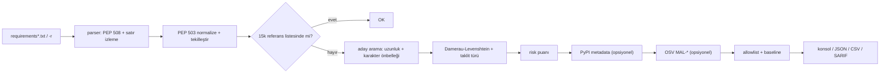

# SupplyGuard

Python bağımlılıkları için **kurulum öncesi** taklit paket (typosquatting) ve
yapay zekâ kaynaklı uydurma paket (slopsquatting) tespit aracı.

BIL 420/520 Siber Güvenliğe Giriş, Güz 2026, dönem projesi.

> SupplyGuard hiçbir paketi indirmez, kurmaz veya çalıştırmaz. Sadece paket
> isimlerine, PyPI'ın herkese açık JSON API'sine ve OSV'nin salt okunur
> sorgu servisine bakar. Hiçbir isim PyPI'a kaydedilmez.

## Neler var?

- **15.000 popüler paketlik referans** (indirme sayıları ve sıralarıyla).
- Damerau-Levenshtein mesafesi + **taklit türü sınıflandırması**:
  transpozisyon, klavye komşusu, homoglif (`rn`→`m`, `l`→`i`, `e`→`3`),
  ayraç, ön/son ek, eksik/fazla harf, substitution.
- PyPI metadata sinyalleri: paketin yaşı, sürüm sayısı, proje linki, açıklama,
  ismin PyPI'da hiç var olmaması.
- **OSV `MAL-*` kontrolü**: bilinen zararlı paketleri doğrudan HIGH yapar.
- **Allowlist** (`.supplyguardignore`), son kullanma tarihi ve gerekçesiyle.
- **Baseline**: CI yalnızca *yeni* bulgular yüzünden kırılır.
- Konsol, **JSON (schema v2)**, CSV ve **SARIF 2.1.0** çıktıları.
- `--fail-on` ile eşik seçilebilir CI çıkış kodu.
- LLM halüsinasyon deneyleri: tekrar, sıcaklık, prompt varyantı ve ham JSONL.
- Yeniden üretilebilir değerlendirme: OpenSSF zararlı isimleri, gerçek PyPI
  negatifleri, güven aralıkları, McNemar testi ve kaçınma (evasion) paketi.

## Hızlı başlangıç

```bash
python -m venv .venv
.venv\Scripts\activate          # Linux/macOS: source .venv/bin/activate
pip install -e ".[dev]"

supplyguard scan examples/requirements-demo.txt --offline
python -m pytest -q
```

Çalışmak için dış bağımlılık gerekmez (sadece standart kütüphane); testler için
`pytest` gerekir.

## Kullanım

```bash
# İsim + PyPI metadata (ağ erişimi var)
supplyguard scan requirements.txt

# Yalnızca isim kontrolü: hızlı, çevrimdışı, deterministik
supplyguard scan requirements.txt --offline --fail-on MEDIUM

# Birden fazla dosya; -r ile içe alınanlar otomatik izlenir
supplyguard scan requirements.txt requirements-dev.txt --offline

# Bilinen zararlı paketleri de sor (OSV, salt okunur)
supplyguard scan requirements.txt --osv

# Raporlar
supplyguard scan requirements.txt --json reports/scan.json \
  --csv reports/scan.csv --sarif reports/scan.sarif

# Kabul edilen yanlış pozitifler + önceki rapora göre baseline
supplyguard scan requirements.txt --ignore .supplyguardignore \
  --baseline reports/baseline.json --fail-on MEDIUM

# Referans listesini güncelle (atomik yazım)
supplyguard update-popular --limit 15000

supplyguard --version
```

### Çıkış kodu

| Durum | Kod |
|---|---|
| `--fail-on` eşiğinde veya üstünde **yeni** bulgu yok | 0 |
| Eşikte/üstünde yeni bulgu var | 1 |
| Geçersiz argüman / deney yapılandırması | 2 |

Allowlist ile bastırılan ve baseline'da bulunan kayıtlar çıkış kodunu etkilemez.
Varsayılan eşik `HIGH`; `--fail-on none` hiç kırmaz.

### `.supplyguardignore`

```text
# isim [until=YYYY-AA-GG] # gerekçe
cfunits until=2027-01-31 # iç paket adı, 2026-11'de incelendi
attr                       # import takma adı; requirements'ta attrs kullanılmalı
```

Süresi geçen kayıtlar uygulanmaz ve tarama sırasında uyarı olarak gösterilir.

### JSON şeması

Rapor bir nesnedir; eski düz liste biçimini okuyan araçlar için
`schema_version`, `tool`, `version`, `generated_at`, `inputs`, `findings`
alanlarını içerir. Baseline yükleyici hem eski listeyi hem yeni nesneyi okur.

## Nasıl çalışır?



Önemli tasarım kararları:

- **Deterministik eşitlik bozma:** aynı güçteki adaylar önce mesafeye, sonra
  referans sırasına (daha popüler), sonra alfabetik sıraya göre seçilir.
  Sonuç küme iterasyon sırasından bağımsızdır.
- **Mesafe 2'de tanınmayan taklit yok sayılır.** `tabula` ↔ `tabulate` gibi
  ilgisiz gerçek paketlerin yanlış pozitif üretmesini engeller.
- **Metadata yokluğu "temiz" değildir.** Ağ hatası uyarı olarak raporlanır;
  ismin PyPI'da bulunmaması (`exists=False`) ayrı bir LOW sinyalidir.
- **Karakter sayımı ön filtresi:** tam düzenleme mesafesinden önce ucuz bir alt
  sınır uygulanır; 200 isimlik tarama 15k referansta ~46 ms/isim seviyesindedir.

### Risk seviyeleri

| Seviye | Puan | Anlam |
|---|---|---|
| `HIGH` | ≥ 0.70 | Güçlü taklit + riskli metadata veya OSV `MAL-*` |
| `MEDIUM` | 0.40–0.69 | Tanınan taklit tekniği |
| `LOW` | 0.0001–0.39 | Zayıf sinyal (uzun affix, yalnızca substitution vb.) |
| `OK` | 0 | Popüler listede veya eşleşme yok |

## Değerlendirme

### Veri seti

- **Pozitifler:** `eval/malicious_names.txt` — OpenSSF/OSV PyPI `MAL-*`
  kayıtlarından **tüm** isimler (12.052). Eski sürüm pozitifleri dedektörün
  kendi benzerlik fonksiyonundan geçiriyordu; bu, tespit edilemeyen vakaları
  veri setinden çıkarıp recall'ı yapay olarak şişiriyordu. Artık yapılmıyor.
- **Negatifler:** `eval/benign_names.txt` — PyPI simple index'ten rastgele
  örneklenen, 15k referans ve zararlı isimler dışında kalan, metadata'sı
  doğrulanmış **471 gerçek proje**.
- **Zor negatifler:** `eval/benign_pairs.csv` yalnızca bağlam için raporlanır;
  içindeki 13 ismin tamamı 15k listesinde olduğu için ana negatif seti değildir.

### Sonuçlar (çevrimdışı, 1.000 pozitif + 471 negatif, eşik MEDIUM)

| Yöntem | Precision [%95 GA] | Recall [%95 GA] | FPR [%95 GA] | F1 |
|---|---|---|---|---|
| Levenshtein ≤ 1 | 0.81 [0.72–0.87] | 0.08 [0.06–0.10] | 0.04 [0.03–0.06] | 0.14 |
| Levenshtein ≤ 2 | 0.68 [0.62–0.73] | 0.18 [0.16–0.20] | 0.18 [0.15–0.22] | 0.28 |
| Damerau ≤ 1 | 0.84 [0.76–0.89] | 0.10 [0.09–0.12] | 0.04 [0.03–0.06] | 0.18 |
| Damerau ≤ 2 | 0.68 [0.62–0.73] | 0.18 [0.16–0.20] | 0.18 [0.15–0.22] | 0.28 |
| **SupplyGuard ≥ MEDIUM** | **0.84 [0.77–0.90]** | **0.10 [0.08–0.12]** | **0.04 [0.03–0.06]** | **0.18** |

**Kapsam tanılaması:** 1.000 zararlı ismin yalnızca 102'si popüler bir hedefe
benziyor. SupplyGuard bu temsil edilebilir alt kümede **0.99 [0.95–1.00]**
recall'a sahiptir. Tam setteki düşük recall, yöntemin başarısızlığından çok
zararlı isimlerin çoğunun rastgele/uydurma olmasından kaynaklanır; bu isimleri
yalnızca OSV gibi bir kara liste yakalayabilir.

**McNemar (SupplyGuard vs Levenshtein ≤ 2):** b=78, c=65, p=0.3156. Bu örneklemde
fark istatistiksel olarak anlamlı değildir; SupplyGuard'ın avantajı aynı FPR'de
taklit türünü ve gerekçesini üretmesi, deterministik olması ve metadata/OSV
sinyallerini birleştirebilmesidir.

**Eşik taraması:** puan eşiği 0.50'ye çekilirse precision 0.91, FPR 0.02 olur
(recall 0.09). Varsayılan MEDIUM eşiği (0.40) substitution ve uzun affix
sinyallerini de kapsamak için bilinçli olarak daha geniştir; sıkı CI için
`--fail-on HIGH` veya `--fail-on MEDIUM` ile birlikte baseline kullanın.
Tam tarama tablosu `eval/run_eval.py --sweep` çıktısındadır.

### Yeniden üretme

```bash
python eval/fetch_openssf.py                    # OSV PyPI dump -> malicious_names.txt
python eval/build_benign.py --sample 500 --seed 420 --verify
python eval/run_eval.py --sweep --json eval/results/eval.json
python eval/run_evasion.py --json eval/results/evasion.json
```

### Kaçınma (evasion) paketi

`python eval/run_evasion.py` 26 vakayı çalıştırır: 19 savunulan teknik, 1
control ve belgelenmiş 6 sınırlama. Savunulan vakaların 17'si MEDIUM+; uzun
affix'ler (`python-requests`, `requests-py`) yalnızca LOW üretir. Belgelenen
kaçışlar: rastgele isim (OSV gerekir), dependency confusion, Unicode homoglif
(PyPI ismi olamaz) ve 15k dışındaki bir projenin taklidi. Belgelenen yanlış
pozitifler: `yaml` ve `PIL` alias'ları. Ayrıntılar:
[`docs/threat-model.md`](docs/threat-model.md).

## LLM deneyleri (slopsquatting)

[Groq](https://console.groq.com) ücretsiz katmanından bir API anahtarı alın ve
ortam değişkeni olarak tanımlayın (anahtarı **asla** koda veya repoya koymayın):

```powershell
$env:GROQ_API_KEY = "..."
supplyguard slopcheck --tasks eval/tasks_en.txt --model llama-3.3-70b-versatile `
  --variant plain --variant cautious --temperature 0.0,0.7,1.0 --repeats 3 `
  --out eval/results/llm_en.jsonl
```

- Her çağrı için ham yanıt, prompt, model, varyant, sıcaklık, tekrar ve süre
  JSONL'e yazılır; hata alan çağrılar deneyi durdurmaz.
- Türkçe görevler: `eval/tasks_tr.txt`.
- Tek seferlik özet: `--out` vermeden `--csv reports/slop.csv`.

Analiz:

```bash
python eval/analyze_llm.py eval/results/llm_en.jsonl \
  --csv eval/results/llm_en.csv --json eval/results/llm_en.json --osv
```

Analiz, her benzersiz ismi PyPI'da bir kez doğrular (`.supplyguard_cache/`) ve
şunları raporlar: çağrı başına halüsinasyon oranı, benzersiz isim oranı,
şüpheli (yeni/az sürümlü) öneriler, en sık uydurulan isimler ve varsa OSV
`MAL-*` eşleşmeleri.

## CI ve pre-commit

`.github/workflows/ci.yml` üç iş çalıştırır:

1. Python 3.10–3.13 matrisinde testler.
2. Örneklemli çevrimdışı değerlendirme (artifact olarak JSON).
3. Demo taraması + SARIF artifact'i + GitHub code scanning yüklemesi.

Kendi deponuzda:

```yaml
- name: SupplyGuard
  run: |
    pip install supplyguard
    supplyguard scan requirements.txt --offline --fail-on MEDIUM \
      --json supplyguard.json --sarif supplyguard.sarif
- uses: github/codeql-action/upload-sarif@v3
  with:
    sarif_file: supplyguard.sarif
```

Pre-commit (çevrimdışı, hızlı):

```yaml
repos:
  - repo: https://github.com/<owner>/supplyguard
    rev: v0.2.0
    hooks:
      - id: supplyguard
```

## Proje yapısı

```text
supplyguard/
  parser.py        requirements okuma, PEP 508/503, -r izleme, BOM
  similarity.py    karakter önbelleği + Levenshtein/Damerau-Levenshtein
  typo_types.py    taklit türü sınıflandırması
  popular.py       15k referans indeksi (sıra, indirme, uzunluk, ayraçsız)
  pypi.py          PyPI JSON API, önbellekli
  osv.py           OSV toplu MAL-* sorgusu
  scoring.py       deterministik aday seçimi + risk puanı
  allowlist.py     .supplyguardignore (süreli bastırma)
  baseline.py      önceki rapora göre yeni bulgu filtresi
  metrics.py       confusion matrix, Wilson GA, McNemar
  report.py        konsol / JSON / CSV / SARIF
  slopsquat.py     LLM önerisi + tekrar/sıcaklık/varyant deneyleri
  cli.py
  data/top_packages.txt
eval/
  fetch_openssf.py   OSV dump -> zararlı isimler
  build_benign.py    gerçek PyPI negatif örneklemi
  run_eval.py        baseline karşılaştırması
  run_evasion.py     kaçınma/control paketi
  analyze_llm.py     ham LLM JSONL analizi
  evasion/cases.json
  tasks_en.txt / tasks_tr.txt
docs/threat-model.md
tests/
```

## Sınırlamalar

- Yalnızca isim ve metadata; paket kodu veya çalışma zamanı davranışı analiz
  edilmez (GuardDog'un tersine, kurulumdan **önce** çalışır).
- 15k dışındaki popüler projelerin taklitleri görülmez.
- Rastgele isimli zararlı paketler yalnızca `--osv` ile yakalanır.
- Dependency confusion isim benzerliğiyle çözülemez; özel isim politikası,
  allowlist ve OSV gerekir.
- PyPI alias'ları (`yaml`, `PIL`) yanlış pozitif üretebilir; `attrs` gibi
  popüler isimler artık referansta olduğu için temizdir.
- OSV ve PyPI gecikmeli olabilir; `--offline` modunda ikisi de kullanılmaz.

Ayrıntılı tehdit modeli ve operasyonel öneriler:
[`docs/threat-model.md`](docs/threat-model.md).

## Ders bağlantısı

Day 13 (güvenli SDLC), Day 14 (yazılım tedarik zinciri, typosquatting,
dependency confusion), Day 16 (tespit kalitesi metrikleri), MITRE ATT&CK T1195.

## Lisans

MIT — bkz. [`LICENSE`](LICENSE).
