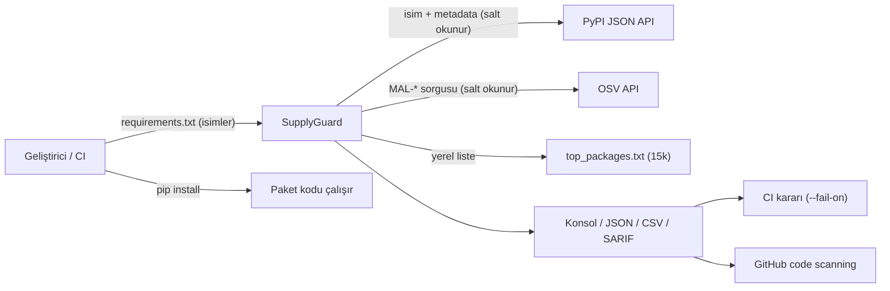

# SupplyGuard Tehdit Modeli

Bu belge SupplyGuard'ın neyi korumayı amaçladığını, hangi saldırıları tespit
ettiğini ve **neyi tespit etmediğini** açıklar. Değerlendirme sayıları ve
kaçınma (evasion) testleri `eval/` altında yeniden üretilebilir.

## 1. Kapsam

SupplyGuard, bir Python projesinin bağımlılık listesi **kurulmadan önce**
okunur ve isim tabanlı risk sinyalleri üretir:

- `requirements*.txt`, `constraints*.txt` ve `-r` ile içe alınan dosyalar
- PEP 503 normalizasyonu (`Python_DateUtil` → `python-dateutil`)
- İsteğe bağlı PyPI JSON API metadata'sı (yaş, sürüm sayısı, proje linki)
- İsteğe bağlı OSV `MAL-*` sorgusu (bilinen zararlı paketler)
- Proje içi allowlist ve önceki rapora göre baseline

**Kapsam dışı:** paket kaynak kodunu indirmek, kurmak veya çalıştırmak;
PyPI'da isim kaydetmek; ağ trafiğini veya çalışma zamanı davranışını izlemek.

## 2. Varlıklar

| Varlık | Neden önemli |
|---|---|
| Geliştiricinin sanal ortamı / CI runner'ı | Kurulum sırasında çalışan `setup.py`, tekerlek (wheel) ve build hook'ları kod çalıştırır |
| Kaynak kod ve sırlar (token, `.env`) | Kötü niyetli paket kurulum anında erişebilir |
| Tedarik zinciri bütünlüğü | Üretim imajına giren bağımlılıklar |
| PyPI isim alanı | Saldırganın kaydedebileceği boş isimler |
| SupplyGuard raporu ve baseline | CI kararının denetlenebilirliği |

## 3. Aktörler

- **Fırsatçı saldırgan:** popüler bir paketin yazım hatasını kaydeder, otomatik
  tarayıcılarla kurban arar.
- **Hedefli saldırgan:** kurbanın kullandığı özel/az bilinen bir paketi veya
  marka adını taklit eder; dependency confusion dener.
- **LLM kullanan geliştirici:** modelin uydurduğu ismi farkında olmadan kurar.
- **İç tehdit / hatalı yapılandırma:** özel paket adının public PyPI'da açık
  kalması, allowlist'in süresiz kötüye kullanımı.
- **Bakımı yapılan araç:** SupplyGuard'ın kendisi; ağ erişimi ve veri
  güncelliği arızalanabilir.

## 4. Güven sınırları

Güven sınırları:

1. **Paket isimleri güvenilmez girdidir.** Çok uzun satırlar, non-ASCII
   karakterler, yorum içindeki gizlenmiş isimler ve `-r` döngüleri dikkate
   alınır.
2. **PyPI/OSV yanıtları güvenilmez ama salt okunur veridir.** Ağ hatası taramayı
   çökertmez; uyarı olarak raporlanır. Metadata yokluğu "temiz" sayılmaz.
3. **Referans liste yerel ve sürümlüdür.** Ağdan güncellenir, atomik yazılır;
   çalışma anında dış servise bağımlı değildir.
4. **Rapor çıktısı CI'ya girdi olur.** CSV formül enjeksiyonu ve SARIF yolu
   gibi çıktı enjeksiyonları temizlenir.

## 5. Tehditler ve kontroller

| # | Tehdit | Örnek | SupplyGuard kontrolü | Kalan risk |
|---|---|---|---|---|
| T1 | Typosquatting | `reqeusts`, `colorma` | Damerau-Levenshtein ≤ 2 + taklit türü sınıflandırması | İsim çok uzaksa veya popüler hedef 15k dışındaysa görülmez |
| T2 | Homoglyph | `rnatplotlib`, `jeiiyfish`, `requ3sts` | `rn`→`m`, `l`→`i`, `e`→`3`, `0`→`o` eşlemeleri | Unicode homoglifler PyPI ismi olamaz; parser satırı reddeder |
| T3 | Combosquatting / affix | `python-requests`, `requests-oauthlib2` | Bilinen ön/son ek sözlüğü | Uzun affix'ler yalnızca LOW sinyal üretir |
| T4 | LLM halüsinasyonu (slopsquatting) | Model `pdfplumberr` önerir | PyPI'da var mı kontrolü + `slopcheck` deney altyapısı | Var olan ama yeni/kötü niyetli paket ayrımı metadata ile sınırlı |
| T5 | Bilinen zararlı paket | Rastgele isimli MAL-* kaydı | `--osv` ile toplu OSV sorgusu, bulguyu HIGH'a yükseltir | OSV gecikmesi; ağ yoksa tespit yok |
| T6 | Dependency confusion | `acme-internal-utils` public PyPI'da | Allowlist + baseline + OSV; isim benzerliği tek başına yetmez | Özel isim politikası olmadan tespit edilemez |
| T7 | Referans dışı popüler paket | 15k dışındaki bir projenin taklidi | 15k liste + metadata sinyalleri | Uzun kuyruk (long tail) kapsanmaz |
| T8 | Requirements sözdizimi ile gizleme | `name[extra]`, `name==1`, `name @ URL`, yorum | PEP 508 ayrıştırıcı, satır/ dosya izleme, `-r` özyineleme tespiti | Dinamik olarak üretilen requirements dosyaları taranmaz |
| T9 | Rapor enjeksiyonu | CSV hücresinde `=cmd|calc` | `'` öneki ile formül etkisizleştirme | Konsol çıktısı terminale göre yorumlanabilir |
| T10 | Allowlist erimesi | Süresiz bastırılan bulgular | `until=YYYY-MM-DD`, süresi geçen kayıt uyarısı | İnsan incelemesi gerekir |
| T11 | Baseline'ın gizlediği yeni risk | Eski bulgu HIGH'a yükselir | Baseline yalnızca aynı ismi işaretler; OSV sonrası çalışır | Baseline periyodik yenilenmeli |
| T12 | Araç kaynaklı DoS | Devasa requirements dosyası | Satır bazlı ayrıştırma, aday ön filtresi (karakter sayımı) | Üst sınır yok; CI'da timeout konulmalı |

## 6. Tespit modeli

| Sinyal | Ağırlık (yaklaşık) |
|---|---|
| Düzenleme mesafesi 1 / 2 | 0.35 / 0.20 |
| Homoglif | +0.30 |
| Transpozisyon, klavye komşusu, ayraç, affix | +0.25 |
| Eksik / fazla harf | +0.15 |
| Değişiklik (substitution) | +0.10 |
| PyPI'da yok | +0.15 |
| 90 günden yeni | +0.20 |
| ≤ 2 sürüm | +0.10 |
| Proje linki yok | +0.10 |
| Açıklama yok | +0.05 |
| OSV `MAL-*` | doğrudan HIGH (1.0) |

Seviyeler: **OK** < 0.0001 ≤ **LOW** < 0.40 ≤ **MEDIUM** < 0.70 ≤ **HIGH**.

Önemli tasarım kararı: mesafe 2'de tanınan bir taklit türü yoksa eşleşme
**kullanılmaz**. `tabula` ile `tabulate` gibi ilgisiz gerçek paketlerin yanlış
pozitif üretmesini engeller; karşılığında bazı gerçek saldırılar kaçar.

## 7. Bilinen sınırlamalar (evasion suite)

`python eval/run_evasion.py` 26 vakayı çalıştırır. Savunulan 19 vakanın
17'si MEDIUM+, ikisi (uzun affix) LOW seviyesindedir. Sonuçlar:

- **Belgelenen kaçışlar (known-gap):**
  - Rastgele isimli zararlı paket (`totally-random-pkg`) → yalnızca OSV yakalar.
  - Dependency confusion (`acme-internal-utils`) → isim sinyali yok.
  - Unicode homoglif (`requеsts`, Kiril `е`) → PyPI ismi olamaz; parser satırı atlar.
  - 15k dışındaki bir projenin taklidi (`abom-cl1`) → referans kapsamı dışında.
- **Belgelenen yanlış pozitifler (known-fp):**
  - `yaml` → gerçek proje, PyYAML'ın eski alias'ı.
  - `PIL` → Pillow'un import adı, PyPI projesi değil.

Bu liste kasıtlıdır: suite bir kaçış "düzelirse" bunu `improved` olarak
raporlar ve veri setinin güncellenmesini ister.

## 8. Veri kaynakları ve güncellik

- **Popüler liste:** `hugovk/top-pypi-packages`, ilk 15.000 proje ve indirme
  sayısı. `supplyguard update-popular --limit 15000` ile atomik güncellenir.
  Liste tarihi raporda ve JSON metadata'sında görünür.
- **OSV:** `https://api.osv.dev/v1/querybatch`, yalnızca `MAL-*` kayıtları.
- **PyPI:** `https://pypi.org/pypi/{name}/json`, yalnızca metadata.
- **Değerlendirme pozitifleri:** OpenSSF/OSV PyPI `MAL-*` isimleri.
- **Değerlendirme negatifleri:** PyPI simple index'ten rastgele örneklenen,
  referans listesi ve zararlı isimler dışında kalan gerçek projeler.

Hiçbir kaynak yazma izni gerektirmez; hiçbir paket indirilmez.

## 9. Operasyonel öneriler

1. CI'da `--fail-on MEDIUM` (veya risk toleransına göre HIGH) kullanın.
2. İlk çalıştırmada `--json` raporu üretip `--baseline` olarak saklayın; yalnızca
   yeni bulguların CI'ı kırmasını sağlayın.
3. Kabul edilen yanlış pozitifleri `.supplyguardignore` içine **gerekçe ve
   son kullanma tarihiyle** ekleyin.
4. İnternet erişimi olan CI adımında `--osv` çalıştırın; olmayan ortamda
   `--offline` kullanın.
5. `update-popular` işini aylık zamanlayın; liste değişimini review edin.
6. SARIF'i GitHub code scanning'e yükleyin; bulguları pull request üzerinde
   görünür kılın.

## 10. Doğrulama

- `python -m pytest -q`: ayrıştırıcı, skorlama, allowlist, baseline, OSV
  (mock'lu), rapor/SARIF ve CLI testleri.
- `python eval/run_eval.py`: 1.000 zararlı + 471 meşru isim üzerinde
  precision/recall/FPR ve Levenshtein/Damerau baseline karşılaştırması.
- `python eval/run_evasion.py`: 26 kaçınma/control vakası.
- `python eval/analyze_llm.py`: LLM deneylerinin ham JSONL çıktısını doğrular.

Ayrıntılı sonuçlar README'de ve `eval/results/` altında (gitignore'lu) tutulur.
